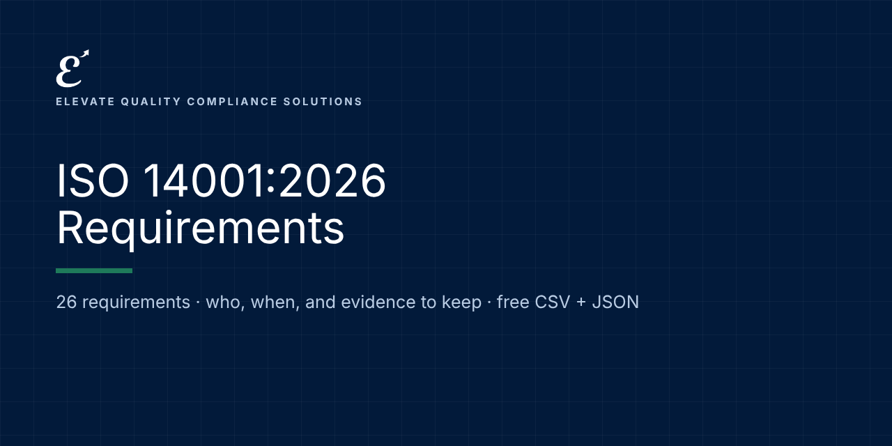

# ISO 14001:2026: Requirements and Evidence

   

**Free, machine-readable ISO 14001:2026 requirements in plain language: who each one applies to, when it applies, and examples of the evidence to keep.** CSV and JSON, ready for Excel, Google Sheets, GRC tools or your own code.

Maintained by [Elevate Quality Compliance Solutions](https://elevateqcs.com). If this saves you time, please ⭐ star the repo so others can find it.

**Source:** ISO 14001:2026 Environmental management systems. Clause references with our own summaries; no ISO text reproduced.
**Official text:** https://www.iso.org/search.html?q=14001

## Key dates
| Date | What applies |
|---|---|
| 2026 | ISO 14001:2026 edition |
| Transition | Check your certification body for the transition deadline |

## How to use it (2 minutes)
1. **Browse online:** [https://elevate-qcs.github.io/iso-14001-2026-requirements/](https://elevate-qcs.github.io/iso-14001-2026-requirements/) and search or filter.
2. **Spreadsheet:** download [`data/requirements.csv`](data/requirements.csv), open it in Excel or Google Sheets, and add columns for status, owner and evidence location. That's your gap assessment.
3. **Code and GRC tools:** load [`data/requirements.json`](data/requirements.json) (format: [`schema/`](schema/requirement.schema.json); examples: [`examples/`](examples/)).

Full guide: [docs/HOW-TO-USE.md](docs/HOW-TO-USE.md) · [FAQ](docs/FAQ.md)

## Requirements (26)
Applies to: organization

| Reference | Requirement | Applies to | From | Evidence examples |
|---|---|---|---|---|
| 4.1 | **Understanding the organization and its context**: Know the internal and external issues, including environmental conditions such as climate, that affect your EMS. | organization | Certifiable | Context register with issues and environmental conditions; review date. |
| 4.2 | **Needs and expectations of interested parties**: Identify interested parties, their requirements, and which become compliance obligations. | organization | Certifiable | Interested-party register; link to compliance obligations. |
| 4.3 | **Scope of the EMS**: Define the EMS boundaries and applicability, considering activities, products and services you control or influence. | organization | Certifiable | Scope statement (documented information), available to interested parties. |
| 4.4 | **Environmental management system**: Establish the EMS and its processes, informed by context. | organization | Certifiable | EMS manual or process description; process interactions. |
| 5.1 | **Leadership and commitment**: Top management is accountable for the EMS and integrates it into business processes. | organization | Certifiable | Management review records; evidence of leaders' involvement and resources. |
| 5.2 | **Environmental policy**: Set a policy committed to environmental protection, compliance and continual improvement. | organization | Certifiable | Approved policy (documented information), communicated and available. |
| 5.3 | **Roles, responsibilities and authorities**: Assign and communicate EMS responsibilities, including reporting on EMS performance. | organization | Certifiable | Role descriptions or RACI, appointment records. |
| 6.1.1 | **Risks and opportunities — general**: Plan to address risks and opportunities from context, aspects and compliance obligations, including emergencies. | organization | Certifiable | Risk and opportunity register (documented information). |
| 6.1.2 | **Environmental aspects**: Identify aspects and impacts with a life cycle perspective and determine significant aspects. | organization | Certifiable | Aspects and impacts register with criteria and significant aspects (documented information). |
| 6.1.3 | **Compliance obligations**: Identify and have access to legal and other requirements and how they apply. | organization | Certifiable | Compliance obligations register (documented information). |
| 6.1.4 | **Planning action**: Plan actions for significant aspects, obligations, risks and opportunities, and how to evaluate their effectiveness. | organization | Certifiable | Action plans linked to registers. |
| 6.2 | **Environmental objectives and planning**: Set measurable objectives and plan what, who, when and how results are evaluated. | organization | Certifiable | Objectives and plans (documented information); progress. |
| 6.3 | **Planning of changes**: Plan changes to the EMS in a controlled way. | organization | Certifiable | Change planning records. |
| 7.1 | **Resources**: Provide the resources the EMS needs. | organization | Certifiable | Resource decisions in management review. |
| 7.2 | **Competence**: Ensure competence of people whose work affects environmental performance or obligations. | organization | Certifiable | Training needs and records (documented evidence). |
| 7.3 | **Awareness**: People know the policy, significant aspects, their contribution and consequences of non-conformance. | organization | Certifiable | Awareness records and quiz results. |
| 7.4 | **Communication**: Plan internal and external communication, including what obligations require. | organization | Certifiable | Communication records (documented evidence as appropriate). |
| 7.5 | **Documented information**: Create, update and control EMS documents and records. | organization | Certifiable | Document list, approvals, retention and access control. |
| 8.1 | **Operational planning and control**: Control processes linked to significant aspects, including outsourced processes and life cycle stages. | organization | Certifiable | Operational controls, contractor requirements, inspection records. |
| 8.2 | **Emergency preparedness and response**: Prepare for and respond to potential emergencies; test responses. | organization | Certifiable | Emergency plans, drill records, incident reports. |
| 9.1.1 | **Monitoring, measurement, analysis and evaluation**: Monitor environmental performance with calibrated equipment and evaluate results. | organization | Certifiable | Monitoring results, calibration records (documented evidence). |
| 9.1.2 | **Evaluation of compliance**: Evaluate fulfilment of compliance obligations at planned intervals. | organization | Certifiable | Evaluation of compliance results (documented evidence). |
| 9.2 | **Internal audit**: Run an audit program with objectives, criteria and scope; report and act. | organization | Certifiable | Audit program and reports (documented evidence). |
| 9.3 | **Management review**: Top management reviews the EMS with all required inputs and records decisions. | organization | Certifiable | Management review minutes (documented evidence). |
| 10.1 | **Continual improvement**: Improve the suitability, adequacy and effectiveness of the EMS to enhance environmental performance. | organization | Certifiable | Improvement actions and results. |
| 10.2 | **Nonconformity and corrective action**: React, find causes, act, verify effectiveness and update the EMS. | organization | Certifiable | Nonconformity and corrective action records. |

## Implementation kit (launching soon)
This repository tells you **what** is required. Our ISO 14001:2026 implementation kit gives you **ready-to-adapt documents** to do it: policies, procedures, forms, workbooks, a Kit Navigator and training, mapped to these requirements.
**[Join the launch list](https://elevateqcs.com/coming-soon)** to be notified.

## Disclaimer
This repository is general information to help you understand and organize work on AI governance frameworks. It is not legal advice and does not guarantee compliance, certification or any regulatory outcome. Requirements are summarized in our own words; always check the official texts and get qualified advice for your situation. ISO and IEC standards are copyrighted: we reference clause numbers with our own summaries and never reproduce their text. Buy the standard from ISO, IEC or your national standards body.

## Corrections and contributions
Spotted an error or a change? [Open a correction](../../issues/new?template=correction.md) with a link to the official source. See [CONTRIBUTING.md](CONTRIBUTING.md).

## Reuse and citation
Free under [CC BY 4.0](LICENSE), including commercially, with credit: *"ISO 14001:2026 Requirements by Elevate Quality Compliance Solutions (elevateqcs.com)"*. See [CITATION.cff](CITATION.cff).

## More open requirements from ElevateQCS
[ISO 9001:2026](https://github.com/elevate-qcs/iso-9001-2026-requirements) · [ISO/IEC 27001:2022](https://github.com/elevate-qcs/iso-27001-2022-requirements) · [NIS2](https://github.com/elevate-qcs/nis2-requirements) · [DORA (Financial Entities)](https://github.com/elevate-qcs/dora-financial-entities-requirements) · [DORA (ICT Providers)](https://github.com/elevate-qcs/dora-ict-providers-requirements) · [EU AI Act](https://github.com/elevate-qcs/eu-ai-act-requirements) · [ISO/IEC 42001](https://github.com/elevate-qcs/iso-42001-requirements) · [NIST AI RMF](https://github.com/elevate-qcs/nist-ai-rmf-requirements) · [GDPR for AI](https://github.com/elevate-qcs/gdpr-ai-requirements)
